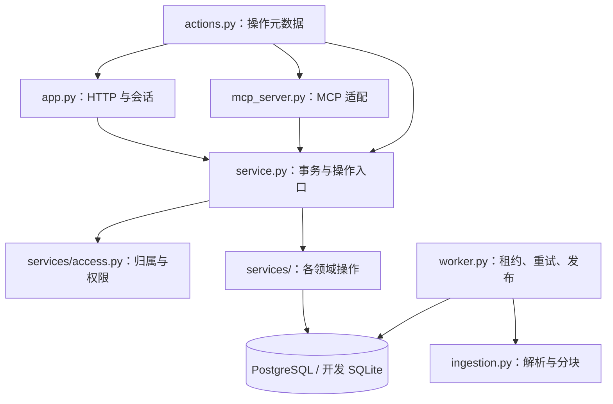

# 代码维护指南

说明性注释与文档字符串统一使用中文，保留代码标识符和工具指令的原样。注释重点解释设计原因、业务约束和容易误用的边界，不逐行复述代码。

本地服务由用户手动启动。修改代码或完成验证后，不自动启动或重启网页服务、后台处理进程或数据库；只有用户明确要求时才代为启动。

## 1. 调用关系



HTTP 和 MCP 仅承担传输适配，不复制业务逻辑。直接字节上传／下载有独立事务入口，但仍调用同一套权限策略。

## 2. 后端文件职责

| 文件 | 职责 |
| --- | --- |
| `rag_center/actions.py` | 请求模型、操作分组、权限、写入标记、MCP 说明的唯一注册表 |
| `rag_center/service.py` | 参数校验、事务入口、写入锁、幂等回执、鉴权顺序与审计 |
| `rag_center/services/access.py` | 实时密钥状态、知识库归属、文件归属与访问范围 |
| `rag_center/services/knowledge_bases.py` | 知识库增删改查 |
| `rag_center/services/documents.py` | 原文来源、文档版本、文件增删改查、任务查询与重试 |
| `rag_center/services/transfers.py` | 上传会话、字节接收、原文件下载与每次请求重新鉴权 |
| `rag_center/services/search.py` | 授权范围内召回、混合排名、来源返回与上下文展开 |
| `rag_center/services/accounts.py` | 网页密钥管理、资源用量、操作记录 |
| `rag_center/services/resources.py` | 显式共享依赖，不保存用户请求状态 |
| `rag_center/services/quota.py` | 用户存储预留、文件数限制 |
| `rag_center/services/storage.py` | 本地文件类型与内容校验 |
| `rag_center/services/serializers.py` | 知识库、文件的公共响应结构 |
| `rag_center/ingestion.py` | 与数据库无关的 PDF／文本解析及分块规则 |
| `rag_center/worker.py` | 领取、续租、处理、缓存复用、原子发布、失败记录和常驻循环 |
| `rag_center/auth.py` | 开发账号密码登录、手机验证码、网页登录会话、API 密钥认证 |

### 新增一个业务操作

1. 在 `schemas.py` 定义请求模型，保留 `extra="forbid"` 和必要的长度、数量限制。
2. 在对应领域类中实现操作，接收已有 `Session`、`Principal`、当前密钥和请求模型。
3. 在 `actions.py` 注册模型、分组、权限与是否写入；需要 MCP 暴露时填写说明。
4. 领域操作不得自行提交事务；由 `Service.run` 将业务修改、审计和幂等回执一起提交。
5. 为权限边界和实际业务结果增加测试。HTTP/MCP 的工具定义无需再维护独立列表。

## 3. 必须保留的约束

- `Principal` 只代表身份，不能当成长期有效的权限快照。每次调用都读取当前密钥状态。
- 处理幂等回执前仍需检查凭证、操作权限及当前资源可见性；重复删除只返回不含原文的回执。
- 完整 API 密钥只在创建时返回，不能进入回执缓存、日志或长期前端状态。
- `rate_limit` 会立即提交计数，必须在业务变更之前调用，不能插入业务事务中间。
- 写入与 worker 发布按“用户 → 文件 → 任务”的顺序持锁。解析和供应商网络请求不放在发布事务里。
- `latest_version` 是最近提交的版本；`current_version` 是已成功发布的版本。只有 worker 发布阶段可推进后者。
- 发布必须重新检查任务 claim、删除状态及最新版本，并保证向量数量与文本块数量一致。
- 修改解析／分块规则时同步更新 `CHUNK_PROFILE`，避免错误复用历史向量。
- 文件系统和 SQL 不属于同一个事务。写入失败可能留下未引用文件；后续接对象存储时需设计补偿清理，不可在回滚时随意删除可能仍被引用的上传源文件。
- 不记录供应商／SQLAlchemy 的原始异常文本，它们可能包含文件正文或凭证。记录任务 ID、异常类型和安全的用户提示即可。

## 4. 前端组织

| 路径 | 职责 |
| --- | --- |
| `src/App.vue` | 根布局、导航与唯一 workspace 的创建和提供 |
| `src/components/*View.vue` | 登录、知识库、搜索、密钥、操作记录等展示和交互 |
| `src/components/WorkspaceDialogs.vue` | 管理弹窗与表单展示 |
| `src/composables/useWorkspace.ts` | 工作空间状态、异步操作编排、轮询和组件生命周期 |
| `src/context.ts` | 类型明确的依赖注入入口；子视图不另建 workspace |
| `src/types.ts` | HTTP 响应和表单类型，不使用 `any` 传递业务数据 |
| `src/api.ts` | 请求、CSRF、错误解释、文件传输和展示格式工具 |
| `src/labels.ts` | 与状态无关的界面文案 |
| `src/style.css` | 统一样式与响应式规则 |

修改响应结构时同步更新后端 serializer 和前端类型。表单使用副本；关闭弹窗清空正文与完整密钥。异步文件列表响应需检查请求序号、知识库、页码和账户，避免过时请求覆盖当前视图。批量上传绑定开始时选定的知识库。

前端已启用严格类型检查及未使用变量检查；格式统一由 Prettier 维护。不要将业务分支重新塞回多条语句的模板事件表达式中。

## 5. 数据库与回归检查

已有迁移是冻结的 schema 快照，不导入当前应用模型。以后修改表结构时新增迁移，不重写 `0001_initial.py`。测试每次使用独立 schema，并显式指定查询和迁移版本表的 schema；即使初始化失败，清理回调也会执行。

`0002_development_login.py` 增加可选用户名并允许手机号为空，保留已有手机号用户及其资源归属。测试密码只从服务端配置读取，不能下发到健康检查响应或页面，也不能在生产环境开放测试登录入口。SQLite 批量迁移重建用户表时，由迁移入口统一切换并恢复当前连接的外键设置。

`0003_index_completion_time.py` 为文档版本增加可空的 `indexed_at`。只能在 worker 发布事务中记录实际完成时间，历史记录不使用创建时间回填。前端 `documentIndex.ts` 统一处理阶段、汇总、完成提醒与轮询间隔；`DocumentIndexStatus.vue` 负责展示，不推测未记录的百分比进度。

```powershell
.venv\Scripts\ruff.exe check rag_center tests scripts migrations
.venv\Scripts\ruff.exe format --check rag_center tests scripts migrations
.venv\Scripts\python.exe -m pytest -q
.venv\Scripts\python.exe -m pytest --postgresql -q

Set-Location frontend
npm.cmd run check
npm.cmd test
npm.cmd run format:check
npm.cmd run build
Set-Location ..

# 运行开发服务后，在实际 Edge 中验证流程；仅创建和删除专用验收资料
.venv\Scripts\python.exe scripts/ui_smoke.py
```

常驻 worker 和开发启动器共用 `Worker.run`。临时数据库／文件系统故障记录安全错误后继续运行；任务内部故障只影响当前任务。
